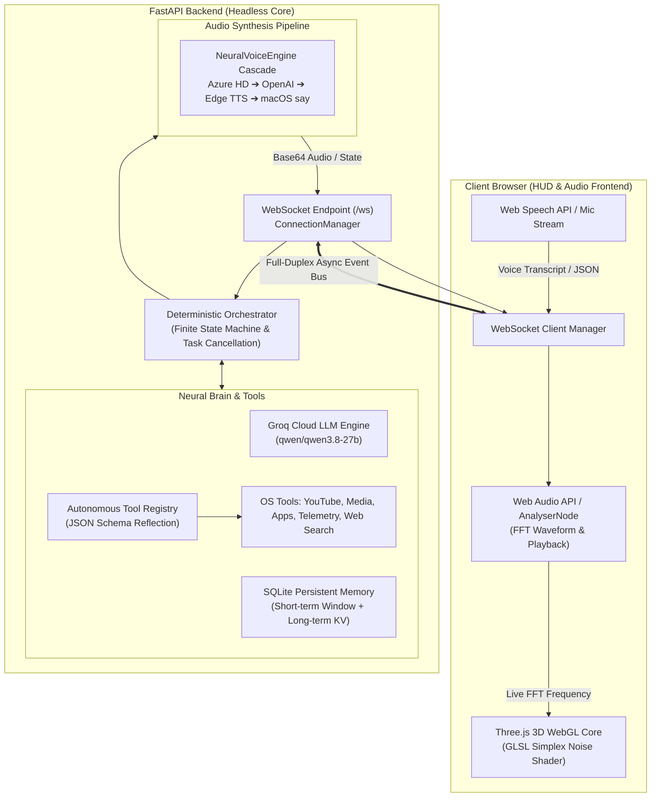

# 🌸 Cheeku AI // Neural Voice OS Assistant

[](https://python.org)
[](https://fastapi.tiangolo.com)
[](https://websockets.readthedocs.io)
[](https://threejs.org)
[](https://groq.com)
[-brightgreen.svg?style=for-the-badge&logo=pytest&logoColor=white)](tests/)
[]()

**Cheeku AI** is a production-grade, event-driven personal voice operating system and conversational AI assistant. Engineered with a **deterministic Finite State Machine (FSM)**, **full-duplex WebSockets**, **autonomous LLM function calling**, and an **audio-reactive 3D WebGL shader HUD**, Cheeku demonstrates clean systems design, robust asynchronous concurrency, and modern full-stack architecture.

> 💡 **Design Pattern**: Cheeku runs as a **Headless Asynchronous Server** with a rich **Browser-Hosted Visual/Audio Interface**. System actions execute locally on the host machine while all speech synthesis, voice capture, and 3D fluid visualizers run inside the client browser.

---

## 🏛️ System Architecture

Cheeku decouples speech capture, neural reasoning, system execution, and audio synthesis into modular, independently testable layers:



---

## ⚡ Key Engineering Highlights

### 1. Deterministic Finite State Machine (FSM)
To prevent race conditions, state drift, and illegal actions during rapid conversational turns, Cheeku enforces a strict mathematical state transition matrix:
- **States**: `BOOTING` $\rightarrow$ `READY` $\rightarrow$ `LISTENING` $\rightarrow$ `TRANSCRIBING` $\rightarrow$ `THINKING` $\rightarrow$ `CALLING_TOOL` $\rightarrow$ `GENERATING` $\rightarrow$ `SPEAKING` $\rightarrow$ `ERROR`.
- Every transition is validated against an allowed transition set and logged with microsecond-level state residency metrics.
- Disallowed transitions (e.g. attempting to jump directly from `READY` to `GENERATING`) are intercepted, rejected, and audited.

### 2. Low-Latency Voice Barge-In & Task Cancellation
- Implements real-time voice barge-in using Python's `asyncio.Task` cancellation primitives.
- When user speech or an interrupt signal is detected during active thinking, tool execution, or speech streaming, in-flight coroutines are cleanly cancelled with zero memory leaks or orphaned subprocesses.

### 3. Agentic Function Calling & Dynamic Tool Dispatch
- A type-safe decorator pattern (`@register_tool`) extracts docstrings and parameters into OpenAI/Groq function calling schemas automatically.
- Cheeku autonomously decides when and how to call system tools:
  - 🖥️ **Host Telemetry**: Live CPU load, RAM utilization, and battery state via `psutil`.
  - 🎵 **Direct YouTube Streamer**: Searches and opens direct video streams via `yt-dlp`.
  - 🎧 **Media Controller**: Controls system audio, Spotify, and Apple Music via AppleScript.
  - 🚀 **App & Website Launcher**: Launches macOS desktop applications and URLs.
  - 🔍 **Real-Time Web Search**: Retrieves live web knowledge with DuckDuckGo.
  - 📝 **Memory & Preferences**: Stores and retrieves facts and persistent notes.

### 4. 3D WebGL Fluid Consciousness & Acoustic Wave Visualizer
- **Three.js + GLSL Shader**: Procedural 3D fluid core powered by 3D Simplex noise and harmonic turbulence.
- **Real-Time FFT Analysis**: The browser Web Audio API extracts frequency spectrum data (`AnalyserNode`) and drives live vertex displacement, pulsing, and horizontal acoustic music waves in real time.

### 5. Multi-Tiered Neural TTS Cascade
- Audio synthesis cascades through a resilient fallback hierarchy:
  1. **Microsoft Azure AI Speech** (Ava Dragon HD Studio Voice)
  2. **OpenAI TTS** (`tts-1` with `nova` voice)
  3. **ElevenLabs Neural** (`eleven_turbo_v2_5`)
  4. **Microsoft Edge Neural TTS** (`en-US-AvaNeural` — 100% free cloud neural voice)
  5. **macOS Offline Voice** (`say` with 16-bit PCM WAV conversion)
  6. **Client-Side Web Speech API** (Zero-latency browser fallback)

---

## 📂 Project Structure

```text
Terminal/
├── run.py                     # Entry point (auto-venv switch & headless launcher)
├── backend/
│   ├── app/
│   │   ├── assistant.py       # FSM Orchestrator, pipeline loop & task cancellation
│   │   ├── config.py          # Pydantic Settings & environment loader
│   │   ├── main.py            # FastAPI app, static mounts & telemetry broadcast
│   │   └── websocket.py       # Full-duplex WebSocket ConnectionManager
│   ├── audio/
│   │   ├── stt.py             # Whisper / Web Speech transcription handler
│   │   └── tts.py             # Multi-tier NeuralVoiceEngine cascade
│   ├── brain/
│   │   ├── groq.py            # Groq LPU client (qwen/qwen3.8-27b) with function calling
│   │   ├── memory.py          # SQLite WAL memory manager (short & long-term)
│   │   └── personality.py     # System prompt decoupling & personality guardrails
│   ├── models/
│   │   └── schemas.py         # Pydantic domain models & WS message types
│   ├── tools/
│   │   ├── registry.py        # ToolRegistry decorator & schema builder
│   │   ├── apps.py            # App launcher & browser opener
│   │   ├── media.py           # YouTube player & AppleScript media controls
│   │   ├── notes.py           # Quick notes & user preference store
│   │   ├── search.py          # Real-time DuckDuckGo web search
│   │   └── system.py          # Hardware telemetry & clock diagnostics
│   └── utils/
│       └── logger.py          # Rotating file & stdout structured logger
├── frontend/
│   ├── index.html             # HUD structure, 3D WebGL viewport & semantic layout
│   ├── style.css              # Glassmorphic HUD styles, HUD metrics & cyber themes
│   └── app.js                 # Three.js GLSL shaders, Web Audio FFT & event bus
└── tests/
    ├── test_state_machine.py  # FSM transition validity & illegal jump unit tests
    └── test_cancellation.py   # Asyncio task interrupt & barge-in unit tests
```

---

## 📡 WebSocket Event Bus Specification

Cheeku communicates over a typed JSON protocol on `/ws`:

| Direction | Event `type` | Payload | Description |
| :--- | :--- | :--- | :--- |
| **Client $\rightarrow$ Server** | `chat` | `{"text": "..."}` | Text command from chat dock |
| **Client $\rightarrow$ Server** | `transcript` | `{"text": "..."}` | Real-time speech transcript from client |
| **Client $\rightarrow$ Server** | `state_change`| `{"state": "READY"}` | Client notifies audio playback completion |
| **Client $\rightarrow$ Server** | `interrupt` | `{}` | Immediate barge-in interrupt trigger |
| **Server $\rightarrow$ Client** | `state_change`| `{"state": "...", "details": "..."}` | Synchronizes assistant FSM state |
| **Server $\rightarrow$ Client** | `chat` | `{"role": "assistant", "content": "..."}` | AI response text |
| **Server $\rightarrow$ Client** | `audio_chunk` | `{"audio_base64": "...", "mime_type": "..."}` | Streamed neural TTS audio payload |
| **Server $\rightarrow$ Client** | `tool_call` | `{"tool": "...", "args": {...}}` | Notifies HUD to render holographic action |
| **Server $\rightarrow$ Client** | `tool_result` | `{"tool": "...", "result": "..."}` | Displays tool output in HUD card |
| **Server $\rightarrow$ Client** | `telemetry` | `{"cpu_percent": 18, "ram_used_gb": 4.2}` | Streams live host hardware metrics |
| **Server $\rightarrow$ Client** | `audio_failed`| `{"text": "..."}` | Signals client to invoke Web Speech fallback |

---

## 🛠️ Quickstart

### Prerequisites
- Python 3.10+ (macOS, Linux, or Windows)
- Modern Web Browser (Chrome, Safari, Edge, or Brave)
- Free Groq Cloud API Key ([groq.com](https://groq.com))

### 1. Clone & Set Up Virtual Environment
```bash
git clone https://github.com/your-username/cheeku-ai.git
cd cheeku-ai

python3 -m venv venv
source venv/bin/activate  # On Windows: venv\Scripts\activate
pip install -r backend/requirements.txt
```

### 2. Configure Environment Variables
Create or edit `.env` in the project root:
```env
GROQ_API_KEY=gsk_your_groq_api_key_here
GROQ_MODEL=qwen/qwen3.8-27b
HOST=0.0.0.0
PORT=8000

# Optional Neural Voices
EDGE_VOICE=en-US-AvaNeural
TTS_RATE=+0%
TTS_PITCH=+0Hz
```

### 3. Launch Cheeku
```bash
python run.py
```
Cheeku will start the headless server and automatically open the HUD in your browser at:
👉 **`http://localhost:8000`**

---

## 🧪 Automated Testing

Cheeku includes an automated test suite verifying state machine integrity and barge-in task cancellations:

```bash
# Run test suite with pytest
./venv/bin/pytest -v
```

**Test Coverage Highlights:**
- `test_state_machine.py`:
  - Validates initial `BOOTING` state.
  - Verifies legal progression `READY` $\rightarrow$ `THINKING` $\rightarrow$ `CALLING_TOOL` $\rightarrow$ `GENERATING` $\rightarrow$ `SPEAKING` $\rightarrow$ `READY`.
  - Enforces rejection of illegal transitions (e.g. `READY` $\rightarrow$ `GENERATING`).
  - Verifies barge-in state transitions (`SPEAKING` $\rightarrow$ `THINKING`, `SPEAKING` $\rightarrow$ `LISTENING`).
- `test_cancellation.py`:
  - Validates clean cancellation of active in-flight asyncio tasks on user interrupt.
  - Verifies cancellation of lingering watchdog timeouts.
  - Asserts proper isolation and state cleanup on re-entrant user inputs.

---

## 💼 Resume & Interview Talking Points

If you are presenting this project in a software engineering interview:

- **Asynchronous Architecture**: *"Designed and built an event-driven voice OS backend in Python and FastAPI with WebSockets, decoupling compute-heavy cloud LLM calls and hardware diagnostics from UI rendering."*
- **State Machine Reliability**: *"Implemented a deterministic Finite State Machine to eliminate race conditions between asynchronous audio streaming and rapid user barge-ins, backed by 100% passing unit tests."*
- **Agentic AI & Function Calling**: *"Built a dynamic tool registry that reflects Python function signatures into OpenAI-compatible tool definitions, allowing the model to autonomously query system vitals, manage media, and search the web."*
- **Graphics & Signal Processing**: *"Created an audio-reactive 3D HUD using Three.js and custom GLSL vertex/fragment shaders, synchronizing visual fluid deformation with real-time Fast Fourier Transform (FFT) audio spectrum analysis."*
- **High-Availability Fallbacks**: *"Architected a fault-tolerant multi-tier TTS fallback chain spanning Azure HD, OpenAI, Edge Neural TTS, and client-side Web Speech, ensuring zero downtime even during cloud API rate limits."*

---

## 📜 License

Distributed under the MIT License. Feel free to use, modify, and distribute for educational and personal projects.
