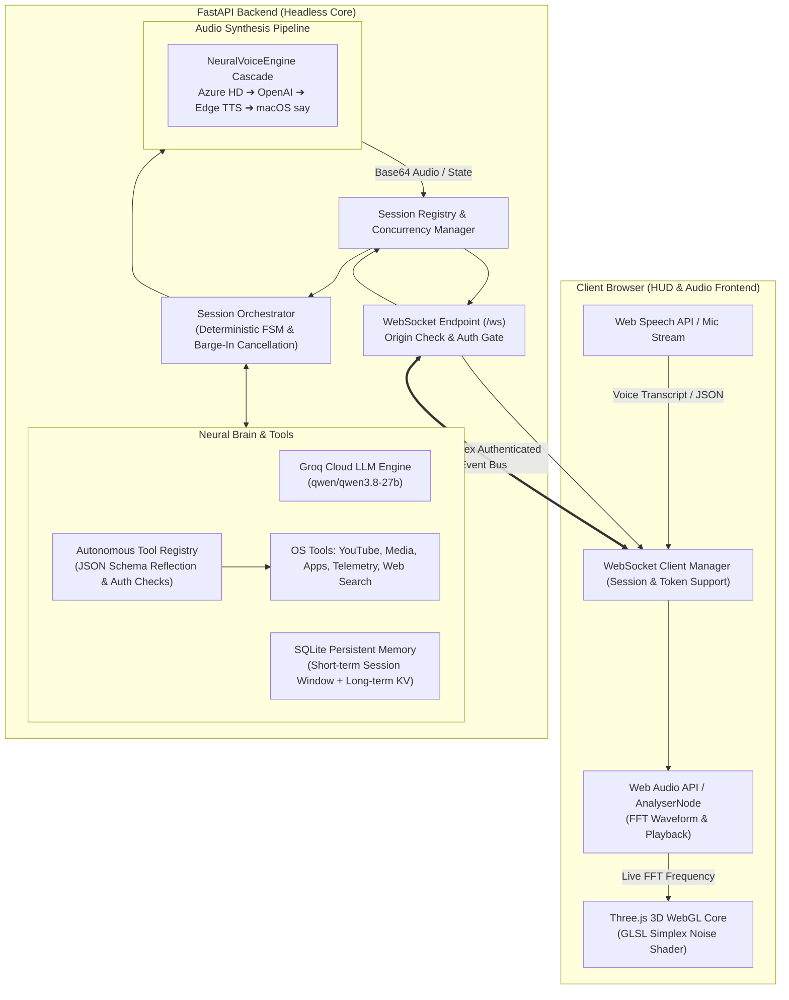

# 🌸 Cheeku AI // Neural Voice Assistant Prototype

[](https://fastapi.tiangolo.com)
[](https://websockets.readthedocs.io)
[](https://threejs.org)
[](https://groq.com)
[](https://cheeku17.vercel.app/)
[]()
[](LICENSE)

**Cheeku AI** is an event-driven personal voice assistant prototype. It combines a **headless asynchronous FastAPI backend** with a **browser-hosted Three.js 3D WebGL HUD**, offering low-latency voice interaction, deterministic state management, isolated client sessions, and sandboxed system tools.

> 🚀 **Live Interactive Web Demo**: Try Cheeku AI directly in your browser without local setup: **[https://cheeku17.vercel.app/](https://cheeku17.vercel.app/)** (features 3D WebGL shader core, live speech recognition, and autonomous tool calling).

> ℹ️ **Prototype Status & Platform Guidance**:
> Cheeku is designed as an advanced personal assistant prototype for local development and experimentation. Host OS integrations (desktop application launching, AppleScript media player control, and master audio volume adjustment) are macOS-specific and fail gracefully on Linux and Windows. Core chat reasoning, real-time web search, SQLite notes, and browser-based audio playback operate cross-platform.

---

## 🏛️ System Architecture

Cheeku decouples speech capture, neural reasoning, system execution, and audio synthesis into modular, independently testable layers:



---

## 🔒 Security Model & Design Principles

Cheeku enforces defensive defaults and strict input validation:

1. **Safe Network Defaults**:
   - Binds to `127.0.0.1` (loopback) by default rather than `0.0.0.0`, preventing unintentional exposure to local network peers.
   - `DEBUG` mode is disabled (`false`) by default to prevent debug leaks in staging or production.

2. **WebSocket Origin Validation**:
   - Validates the `Origin` header on every incoming WebSocket connection against `ALLOWED_ORIGINS` to guard against Cross-Site WebSocket Hijacking (CSWSH).
   - Can be configured for specific domains or local dev hosts (`http://localhost:8000`, `http://127.0.0.1:8000`).

3. **Secure-by-Default WebSocket Authentication & Query Sanitization**:
   - Authentication is required by default (`WS_AUTH_REQUIRED=true`).
   - If `AUTH_TOKEN` is not explicitly set in `.env`, Cheeku auto-generates a cryptographically secure 24-character token saved to `backend/.cheeku_token` (file permission `0o600`).
   - `run.py` automatically starts the local browser with the generated token (`/?token=...`), ensuring frictionless local development while strictly guarding against unauthenticated access if the server port is reachable across a LAN.
   - **Browser URL Sanitization**: The frontend immediately removes `?token=...` from the browser address bar upon page load using `window.history.replaceState`, preventing the token from lingering in the user's browser history or devtools bar.
   - Supports query param (`/ws?token=...`) or `Authorization: Bearer <token>` header, verified with constant-time comparison (`secrets.compare_digest`).

4. **In-Band Session Resumption & Anti-Hijacking**:
   - Every client connection is assigned a server-generated `session_id` and a secret 256-bit `session_token`.
   - **Zero Session Tokens in Query Parameters**: Reconnecting clients resume sessions strictly via in-band WebSocket data frames (`{"type": "session_resume", "payload": {"session_id": "...", "session_token": "..."}}`). Session tokens are never appended to URL query parameters where they could leak into reverse-proxy access logs or browser history.
   - Clients cannot hijack another connection's session or overwrite its active WebSocket reference by supplying an arbitrary `session_id`.
   - Disconnect cleanup validates socket ownership before releasing resources, ensuring one connection's disconnect cannot terminate or disrupt another client's session.
   - **Partitioned Preferences, Notes & Memory**: User preferences (`kv_memory`), quick notes, and short-term conversation context are strictly partitioned per session in SQLite with composite primary keys `(session_id, key)`. Context summaries and personalized facts recorded in Session Alpha are completely isolated from Session Beta.

5. **Payload Size Limits & Strict Schema Validation**:
   - Maximum WebSocket frame size enforced at 1 MB (`MAX_PAYLOAD_BYTES`), protecting against memory exhaustion denial-of-service.
   - Incoming JSON messages are strictly parsed and validated against typed Pydantic models. Malformed frames are rejected with structured error messages without crashing the server.

6. **Tool Authorization & Sandboxing (Disabled by Default)**:
   - System action tools (`launch_application`, `open_website`, `control_media_player`, `set_system_volume`, `play_youtube_video`) are disabled by default (`ENABLE_SYSTEM_ACTIONS=false`) for defensive posture.
   - Users must explicitly opt in by setting `ENABLE_SYSTEM_ACTIONS=true` in `.env`.
   - **App Launching**: Restricted to a configurable allowlist (`ALLOWED_SYSTEM_APPS`) with strict regex validation to prevent path traversal or shell argument injection.
   - **Website Opening**: Strictly enforces `http://` and `https://` URL schemes with valid host domains. Rejects `file://`, `javascript:`, `data:`, and command injection characters.
   - **AppleScript Media & Volume**: Enforces action enum allowlists (`play`, `pause`, `playpause`, `next`, `previous`) and numeric volume clamping (0–100%) to prevent AppleScript injection.

7. **Log Sanitization & Sensitive Data Protection**:
   - Sensitive user tokens, raw conversation frames, and full memory values are excluded from logs.
   - External API error handling masks request credentials and avoids logging sensitive upstream payloads.

---

## ⚡ Concurrency & State Management

- **Client Session Isolation**: Each connected WebSocket client is assigned an isolated session (`session_id`). Conversation turns, short-term history, in-flight coroutines, preferences, notes, and state machine transitions do not collide between clients.
- **Voice Barge-In & Overlapping Turn Handling**: When a new speech transcript or user chat arrives while a turn is processing, the in-flight pipeline task (`_current_task`) is cancelled cleanly using `asyncio` cancellation primitives.
- **Disconnect Cleanup**: When a WebSocket disconnects, all active in-flight tasks and timeout timers for that session are cancelled and awaited immediately to prevent orphaned coroutines or background resource leaks.
- **Graceful Server Shutdown**: The application lifespan manager tracks all running background tasks (such as the telemetry broadcaster and active sessions), cancels them, and awaits completion during shutdown.

---

## 📂 Project Structure

```text
Cheeku/
├── run.py                     # Entry point (auto-venv switch & browser launcher)
├── run.sh                     # Executable launch script
├── pytest.ini                 # Pytest test configuration & deprecation filters
├── demo/                      # Standalone zero-server Vercel web demo (cheeku17.vercel.app)
│   ├── index.html             # Demo HUD & Three.js WebGL canvas
│   ├── style.css              # Cyber-HUD responsive styling
│   ├── app.js                 # Standalone client engine (Web Speech & autonomous brain)
│   └── vercel.json            # Vercel deployment configuration
├── backend/
│   ├── app/
│   │   ├── assistant.py       # Deterministic FSM, session orchestrators & barge-in
│   │   ├── config.py          # Validated Pydantic settings & environment loader
│   │   ├── main.py            # FastAPI app, security middleware & WS endpoint
│   │   └── websocket.py       # Targeted connection & broadcast manager
│   ├── audio/
│   │   ├── stt.py             # Whisper / Web Speech transcription handler
│   │   └── tts.py             # Multi-tier NeuralVoiceEngine cascade
│   ├── brain/
│   │   ├── groq.py            # Groq LPU client with OpenAI-compatible tool calling
│   │   ├── memory.py          # SQLite WAL memory manager (isolated per session)
│   │   └── personality.py     # System prompt & conversational guardrails
│   ├── models/
│   │   └── schemas.py         # Pydantic domain models, WS schemas & inbound validators
│   ├── tools/
│   │   ├── registry.py        # Tool registry, authorization gate & timeout wrapper
│   │   ├── apps.py            # Validated app launcher & browser opener
│   │   ├── media.py           # YouTube player & AppleScript media controls
│   │   ├── notes.py           # Quick notes & user preference store (session-scoped)
│   │   ├── search.py          # Async DuckDuckGo web search
│   │   └── system.py          # Hardware vitals & chronometer
│   └── utils/
│       └── logger.py          # Structured rotating logger
├── frontend/
│   ├── index.html             # HUD structure & 3D WebGL viewport
│   ├── style.css              # Cyber-HUD themes & responsive layout
│   └── app.js                 # Three.js GLSL shaders, in-band session resume & WS bridge
└── tests/
    ├── conftest.py            # Root directory sys.path configuration
    ├── test_state_machine.py  # FSM transition validity & illegal jump unit tests
    ├── test_cancellation.py   # Asyncio task interrupt & barge-in unit tests
    ├── test_auth_and_origins.py # Origin validation & token authentication tests
    ├── test_message_validation.py # Frame size limits & schema validation tests
    ├── test_tool_security.py  # Input sanitization, whitelist & injection tests
    ├── test_session_isolation.py # Multi-client isolation, session resumption & memory partition tests
    ├── test_concurrency_and_lifecycle.py # Overlapping turns & shutdown tests
    └── test_error_handling.py # External API timeouts, fallbacks & recovery tests
```

---

## 🌐 Live Web Demo on Vercel

Test Cheeku AI instantly in your browser without local dependencies or Python setup:

👉 **[https://cheeku17.vercel.app/](https://cheeku17.vercel.app/)**

### Demo Highlights
- **Zero-Backend Cloud Execution**: Completely runs in the client browser with no local server required.
- **Three.js WebGL Simplex Core**: Living liquid plasma sphere deforming organically to audio levels, accompanied by an acoustic wave ribbon.
- **Voice Recognition & Speech**: Web Speech API integration with real-time VisionOS-inspired live transcription pill and spoken audio responses.
- **Dual-Mode Autonomous Brain**:
  - **Built-in Brain (Default)**: High-speed conversational reasoning that simulates system vitals diagnostics, YouTube music streaming, quick note taking, witty jokes, and capabilities.
  - **Live Groq Cloud (Optional)**: Open the ⚙️ **Settings** drawer to connect your Groq Cloud API key for live unconstrained LLM generation.
- **Interactive Prompt Chips**: Quick-tap action chips for effortless exploration on mobile, tablet, and desktop devices.

---

## 🛠️ Quickstart

### Prerequisites
- **Python**: 3.10 to 3.14
- **Operating System**: macOS recommended for full desktop features; Linux and Windows supported for chat, search, notes, and browser audio.
- **Web Browser**: Chrome, Safari, Edge, or Brave with Web Audio API support.
- **API Key**: Free Groq Cloud API key from [groq.com](https://groq.com) (for LLM reasoning).

### 1. Installation

```bash
# Clone repository
git clone https://github.com/your-username/cheeku.git
cd Cheeku

# Create and activate virtual environment
python3 -m venv venv
source venv/bin/activate  # On Windows: venv\Scripts\activate

# Install dependencies
pip install -r requirements.txt
```

### 2. Configure Environment

Copy `.env.example` to `.env`:

```bash
cp .env.example .env
```

Edit `.env` to configure your settings:

```ini
# Core Server Configuration
HOST=127.0.0.1
PORT=8000
DEBUG=false

# WebSocket Security (Secure by default: token required)
# If AUTH_TOKEN is left unset, Cheeku auto-generates a token and run.py launches with it.
# To enforce a custom static token:
# AUTH_TOKEN=your_custom_secret_key
WS_AUTH_REQUIRED=true
ALLOWED_ORIGINS=http://localhost:8000,http://127.0.0.1:8000
ALLOW_ALL_ORIGINS=false
MAX_PAYLOAD_BYTES=1048576

# System Actions (Disabled by default for security)
# Set to true to authorize launching local apps, media control, and volume changes:
ENABLE_SYSTEM_ACTIONS=false
ALLOWED_SYSTEM_APPS=Safari,Google Chrome,Spotify,Terminal,Notes,Calculator,Visual Studio Code,Slack,Music,System Settings
REQUEST_TIMEOUT_SECONDS=15.0

# Groq Cloud Brain
GROQ_API_KEY=gsk_your_groq_api_key_here
GROQ_MODEL=qwen/qwen3.8-27b

# Optional: High-Quality Voice Synthesis
EDGE_VOICE=en-US-AvaNeural
TTS_RATE=+0%
TTS_PITCH=+0Hz
```

### 3. Start the Server

```bash
python run.py
```

The server binds to `http://127.0.0.1:8000` and automatically launches your default browser with the session token attached.

To connect manually with a configured or auto-generated token:
👉 `http://127.0.0.1:8000/?token=your_auth_token`

---

## 🧪 Automated Test Suite

Cheeku includes a comprehensive automated test suite with **38 passing tests** across 8 test modules with **zero warnings**. All external APIs and OS subprocesses are safely mocked, and optional dependencies (`psutil`, `edge_tts`, `duckduckgo_search`) fail gracefully with built-in fallbacks.

To run the complete test suite:

```bash
python3 -m pytest -q
# or
./venv/bin/pytest -v
```

### Test Coverage Summary:
- `tests/test_auth_and_origins.py`: Validates allowed and disallowed origins, CSWSH prevention, token enforcement in query params and headers, auto-generated local tokens, and secure-by-default posture.
- `tests/test_session_isolation.py`: Tests that concurrent WebSocket client connections maintain isolated short-term conversation histories in memory and SQLite, verifies in-band cryptographic session token resumption without query parameters, asserts per-session user preference and note isolation, and guarantees unauthorized clients cannot hijack another connection's session or cause disconnect cleanup interference.
- `tests/test_message_validation.py`: Tests maximum frame payload limits, malformed JSON handling, unsupported message types, and schema validation.
- `tests/test_tool_security.py`: Tests policy gates (`ENABLE_SYSTEM_ACTIONS=false` by default), application name allowlists, shell metacharacter rejection, URL scheme restrictions (`file://`, `javascript:` blocked), AppleScript injection guards, and volume clamping.
- `tests/test_concurrency_and_lifecycle.py`: Tests barge-in cancellation on rapid overlapping turns, client disconnect task cleanup, and server shutdown awaiting.
- `tests/test_error_handling.py`: Tests Groq timeouts, upstream HTTP errors, TTS fallback cascades, STT model unavailability, and tool exception handling.
- `tests/test_state_machine.py`: Tests deterministic FSM transitions, legal sequences, illegal jump rejections, and forced recovery.
- `tests/test_cancellation.py`: Tests asyncio task interruption and watchdog timeout cancellation.

---

## 🏗️ Production Hardening & Multi-User Architecture

Cheeku is currently optimized as a **single-user local desktop assistant prototype** featuring deep macOS host integration (AppleScript media control, local application launching, and local audio pipeline). Transitioning to a **multi-user production cloud service** requires several architectural adaptations:

| Dimension | Single-User Prototype (Current) | Multi-User Cloud Service (Target Architecture) |
|---|---|---|
| **Identity & Authentication** | Shared static / auto-generated bearer token (`AUTH_TOKEN`) | OIDC / OAuth2 with per-user signed JWTs containing user claims (`sub`, `tenant_id`, `roles`) |
| **Session Resumption** | Ephemeral in-memory `SessionRegistry` + SQLite token validation | Distributed Redis session store with TTL-backed secret hashes |
| **URL & Token Hygiene** | In-band `session_resume` frame + `history.replaceState` | Secure HTTP-only cookies or short-lived WebSocket upgrade tickets (one-time nonce) |
| **User Data Partitioning** | SQLite WAL with `(session_id, key)` composite primary key | PostgreSQL / CockroachDB with Row Level Security (RLS) or separate tenant schemas |
| **Tool Execution & Sandboxing** | Local host OS subprocesses (`open -a`, AppleScript, local mic) | Sandboxed microVMs (Firecracker / gVisor) or containerized worker tasks with zero host access |
| **Scalability & Clustering** | Single FastAPI process using in-memory `asyncio.Task` | Clustered FastAPI instances behind an Envoy/Nginx load balancer + Redis Pub/Sub backplane |
| **Audio Synthesis (TTS)** | On-node cascade (Azure HD ➔ OpenAI ➔ Edge TTS ➔ macOS say) | Dedicated async audio microservice with client-side streaming or edge audio distribution |

### Deployment Best Practices
1. **TLS / WSS Termination**: Always place the server behind a reverse proxy (e.g. Nginx, Caddy, Cloudflare) that terminates TLS (`https://` and `wss://`). Never send tokens or audio data over unencrypted plain HTTP/WS outside loopback.
2. **Reverse Proxy Configuration**: Ensure WebSocket upgrade headers (`Upgrade $http_upgrade; Connection "upgrade";`) and timeout parameters are configured on the reverse proxy.
3. **Multi-User Authentication**: For multi-user environments, replace single-tenant `AUTH_TOKEN` with signed JWTs or session cookies tied to a user database.
4. **Rate Limiting**: Implement network rate limiting on the reverse proxy or middleware to mitigate abuse of LLM and TTS upstream APIs.
5. **Sandboxing in Cloud Environments**: System tools that manipulate host applications (`launch_application`, `control_media_player`) are intended for a local desktop assistant. When deploying to containerized or cloud environments, ensure `ENABLE_SYSTEM_ACTIONS=false` is enforced.

---

## 📜 License

Distributed under the MIT License. See `LICENSE` for details.
