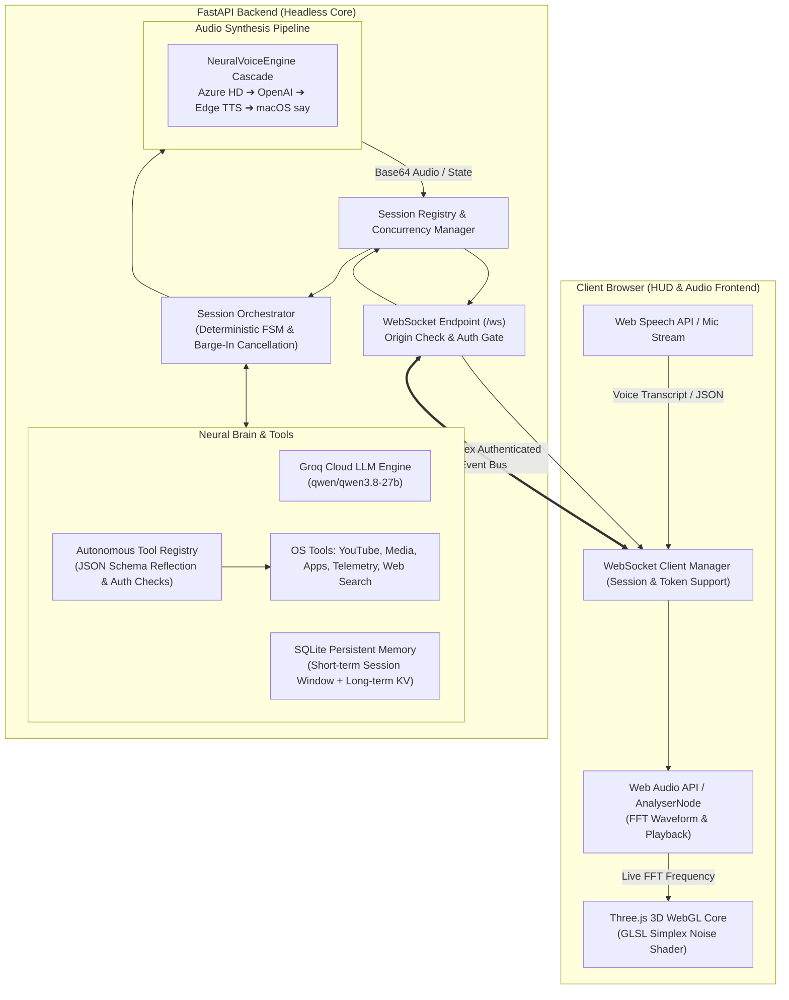

# 🌸 Cheeku AI // Neural Voice Assistant Prototype

[](https://fastapi.tiangolo.com)
[](https://websockets.readthedocs.io)
[](https://threejs.org)
[](https://groq.com)
[]()
[](LICENSE)

**Cheeku AI** is an event-driven personal voice assistant prototype. It combines a **headless asynchronous FastAPI backend** with a **browser-hosted Three.js 3D WebGL HUD**, offering low-latency voice interaction, deterministic state management, isolated client sessions, and sandboxed system tools.

> ℹ️ **Prototype Status & Platform Guidance**:
> Cheeku is designed as an advanced personal assistant prototype for local development and experimentation. Host OS integrations (desktop application launching, AppleScript media player control, and master audio volume adjustment) are macOS-specific and fail gracefully on Linux and Windows. Core chat reasoning, real-time web search, SQLite notes, and browser-based audio playback operate cross-platform.

---

## 🏛️ System Architecture

Cheeku decouples speech capture, neural reasoning, system execution, and audio synthesis into modular, independently testable layers:



---

## 🔒 Security Model & Design Principles

Cheeku enforces defensive defaults and strict input validation:

1. **Safe Network Defaults**:
   - Binds to `127.0.0.1` (loopback) by default rather than `0.0.0.0`, preventing unintentional exposure to local network peers.
   - `DEBUG` mode is disabled (`false`) by default to prevent debug leaks in staging or production.

2. **WebSocket Origin Validation**:
   - Validates the `Origin` header on every incoming WebSocket connection against `ALLOWED_ORIGINS` to guard against Cross-Site WebSocket Hijacking (CSWSH).
   - Can be configured for specific domains or local dev hosts (`http://localhost:8000`, `http://127.0.0.1:8000`).

3. **Configurable WebSocket Authentication**:
   - Supports pre-shared token authentication via `AUTH_TOKEN` in `.env`.
   - Clients supply the token via query parameter (`/ws?token=...`) or `Authorization: Bearer <token>` header.
   - Tokens are validated with constant-time comparison (`secrets.compare_digest`).
   - Default: Safe local development mode (no token required when `AUTH_TOKEN` is unset and `WS_AUTH_REQUIRED=false`).

4. **Payload Size Limits & Strict Schema Validation**:
   - Maximum WebSocket frame size enforced at 1 MB (`MAX_PAYLOAD_BYTES`), protecting against memory exhaustion denial-of-service.
   - Incoming JSON messages are strictly parsed and validated against typed Pydantic models. Malformed frames are rejected with structured error messages without crashing the server.

5. **Tool Authorization & Sandboxing**:
   - Potentially sensitive system actions (`launch_application`, `open_website`, `control_media_player`, `set_system_volume`, `play_youtube_video`) are gated behind `ENABLE_SYSTEM_ACTIONS=true`.
   - **App Launching**: Restricted to a configurable allowlist (`ALLOWED_SYSTEM_APPS`) with strict regex validation to prevent path traversal or shell argument injection.
   - **Website Opening**: Strictly enforces `http://` and `https://` URL schemes with valid host domains. Rejects `file://`, `javascript:`, `data:`, and command injection characters.
   - **AppleScript Media & Volume**: Enforces action enum allowlists (`play`, `pause`, `playpause`, `next`, `previous`) and numeric volume clamping (0–100%) to prevent AppleScript injection.

6. **Log Sanitization & Sensitive Data Protection**:
   - Sensitive user tokens, raw conversation frames, and full memory values are excluded from logs.
   - External API error handling masks request credentials and avoids logging sensitive upstream payloads.

---

## ⚡ Concurrency & State Management

- **Client Session Isolation**: Each connected WebSocket client is assigned an isolated session (`session_id`). Conversation turns, short-term history, in-flight coroutines, and state machine transitions do not collide between clients.
- **Voice Barge-In & Overlapping Turn Handling**: When a new speech transcript or user chat arrives while a turn is processing, the in-flight pipeline task (`_current_task`) is cancelled cleanly using `asyncio` cancellation primitives.
- **Disconnect Cleanup**: When a WebSocket disconnects, all active in-flight tasks and timeout timers for that session are cancelled and awaited immediately to prevent orphaned coroutines or background resource leaks.
- **Graceful Server Shutdown**: The application lifespan manager tracks all running background tasks (such as the telemetry broadcaster and active sessions), cancels them, and awaits completion during shutdown.

---

## 📂 Project Structure

```text
Cheeku/
├── run.py                     # Entry point (auto-venv switch & browser launcher)
├── backend/
│   ├── app/
│   │   ├── assistant.py       # Deterministic FSM, session orchestrators & barge-in
│   │   ├── config.py          # Validated Pydantic settings & environment loader
│   │   ├── main.py            # FastAPI app, security middleware & WS endpoint
│   │   └── websocket.py       # Targeted connection & broadcast manager
│   ├── audio/
│   │   ├── stt.py             # Whisper / Web Speech transcription handler
│   │   └── tts.py             # Multi-tier NeuralVoiceEngine cascade
│   ├── brain/
│   │   ├── groq.py            # Groq LPU client with OpenAI-compatible tool calling
│   │   ├── memory.py          # SQLite WAL memory manager (KV facts & notes)
│   │   └── personality.py     # System prompt & conversational guardrails
│   ├── models/
│   │   └── schemas.py         # Pydantic domain models, WS schemas & inbound validators
│   ├── tools/
│   │   ├── registry.py        # Tool registry, authorization gate & timeout wrapper
│   │   ├── apps.py            # Validated app launcher & browser opener
│   │   ├── media.py           # YouTube player & AppleScript media controls
│   │   ├── notes.py           # Quick notes & user preference store
│   │   ├── search.py          # Async DuckDuckGo web search
│   │   └── system.py          # Hardware vitals & chronometer
│   └── utils/
│       └── logger.py          # Structured rotating logger
├── frontend/
│   ├── index.html             # HUD structure & 3D WebGL viewport
│   ├── style.css              # Cyber-HUD themes & responsive layout
│   └── app.js                 # Three.js GLSL shaders, Web Audio FFT & WS bridge
└── tests/
    ├── conftest.py            # Root directory sys.path configuration
    ├── test_state_machine.py  # FSM transition validity & illegal jump unit tests
    ├── test_cancellation.py   # Asyncio task interrupt & barge-in unit tests
    ├── test_auth_and_origins.py # Origin validation & token authentication tests
    ├── test_message_validation.py # Frame size limits & schema validation tests
    ├── test_tool_security.py  # Input sanitization, whitelist & injection tests
    ├── test_session_isolation.py # Multi-client isolation & session state tests
    ├── test_concurrency_and_lifecycle.py # Overlapping turns & shutdown tests
    └── test_error_handling.py # External API timeouts, fallbacks & recovery tests
```

---

## 🛠️ Quickstart

### Prerequisites
- **Python**: 3.10 to 3.14
- **Operating System**: macOS recommended for full desktop features; Linux and Windows supported for chat, search, notes, and browser audio.
- **Web Browser**: Chrome, Safari, Edge, or Brave with Web Audio API support.
- **API Key**: Free Groq Cloud API key from [groq.com](https://groq.com) (for LLM reasoning).

### 1. Installation

```bash
# Clone repository
git clone https://github.com/your-username/cheeku.git
cd Cheeku

# Create and activate virtual environment
python3 -m venv venv
source venv/bin/activate  # On Windows: venv\Scripts\activate

# Install dependencies
pip install -r backend/requirements.txt
```

### 2. Configure Environment

Copy `.env.example` to `.env`:

```bash
cp .env.example .env
```

Edit `.env` to configure your settings:

```ini
# Core Server Configuration
HOST=127.0.0.1
PORT=8000
DEBUG=false

# WebSocket Security (Safe local-dev defaults: no token required)
# To enforce authentication:
# AUTH_TOKEN=your_custom_secret_key
# WS_AUTH_REQUIRED=true
ALLOWED_ORIGINS=http://localhost:8000,http://127.0.0.1:8000
ALLOW_ALL_ORIGINS=false
MAX_PAYLOAD_BYTES=1048576

# System Actions
ENABLE_SYSTEM_ACTIONS=true
ALLOWED_SYSTEM_APPS=Safari,Google Chrome,Spotify,Terminal,Notes,Calculator,Visual Studio Code,Slack,Music,System Settings
REQUEST_TIMEOUT_SECONDS=15.0

# Groq Cloud Brain
GROQ_API_KEY=gsk_your_groq_api_key_here
GROQ_MODEL=qwen/qwen3.8-27b

# Optional: High-Quality Voice Synthesis
EDGE_VOICE=en-US-AvaNeural
TTS_RATE=+0%
TTS_PITCH=+0Hz
```

### 3. Start the Server

```bash
python run.py
```

The server binds to `http://127.0.0.1:8000` and automatically launches your default browser.

If you have configured `AUTH_TOKEN`, access the interface with your token:
👉 `http://127.0.0.1:8000/?token=your_custom_secret_key`

---

## 🧪 Automated Test Suite

Cheeku includes a comprehensive automated test suite with **34 passing tests** across 8 test modules. All external APIs and OS subprocesses are safely mocked.

To run the complete test suite:

```bash
./venv/bin/pytest -v
```

### Test Coverage Summary:
- `tests/test_auth_and_origins.py`: Validates allowed and disallowed origins, CSWSH prevention, token enforcement in query params and headers, and safe local-dev defaults.
- `tests/test_message_validation.py`: Tests maximum frame payload limits, malformed JSON handling, unsupported message types, and schema validation.
- `tests/test_tool_security.py`: Tests policy gates (`ENABLE_SYSTEM_ACTIONS`), application name allowlists, shell metacharacter rejection, URL scheme restrictions (`file://`, `javascript:` blocked), AppleScript injection guards, and volume clamping.
- `tests/test_session_isolation.py`: Tests that concurrent WebSocket client connections maintain isolated short-term conversation histories and independent states.
- `tests/test_concurrency_and_lifecycle.py`: Tests barge-in cancellation on rapid overlapping turns, client disconnect task cleanup, and server shutdown awaiting.
- `tests/test_error_handling.py`: Tests Groq timeouts, upstream HTTP errors, TTS fallback cascades, STT model unavailability, and tool exception handling.
- `tests/test_state_machine.py`: Tests deterministic FSM transitions, legal sequences, illegal jump rejections, and forced recovery.
- `tests/test_cancellation.py`: Tests asyncio task interruption and watchdog timeout cancellation.

---

## ⚠️ Deployment & Production Considerations

If deploying Cheeku beyond a local workstation prototype:

1. **TLS / WSS Termination**: Always place the server behind a reverse proxy (e.g. Nginx, Caddy, Cloudflare) that terminates TLS (`https://` and `wss://`). Never send tokens or audio data over unencrypted plain HTTP/WS outside loopback.
2. **Reverse Proxy Configuration**: Ensure WebSocket upgrade headers (`Upgrade $http_upgrade; Connection "upgrade";`) and timeout parameters are configured on the reverse proxy.
3. **Multi-User Authentication**: For multi-user environments, replace single-tenant `AUTH_TOKEN` with signed JWTs or session cookies tied to a user database.
4. **Rate Limiting**: Implement network rate limiting on the reverse proxy or middleware to mitigate abuse of LLM and TTS upstream APIs.
5. **Sandboxing in Cloud Environments**: System tools that manipulate host applications (`launch_application`, `control_media_player`) are intended for a local desktop assistant. When deploying to containerized or cloud environments, set `ENABLE_SYSTEM_ACTIONS=false` in `.env`.

---

## 📜 License

Distributed under the MIT License. See `LICENSE` for details.
